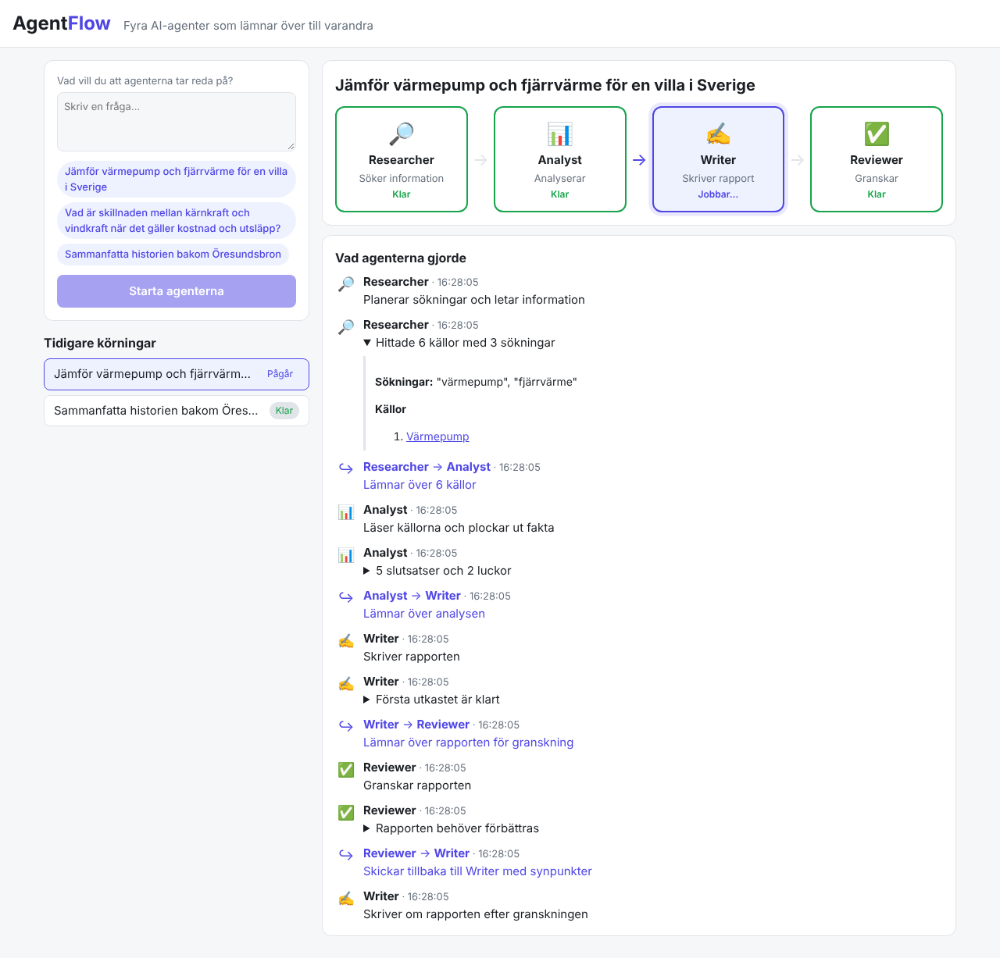

# AgentFlow

Ett multiagentsystem där fyra AI-agenter med olika roller lämnar över uppgifter till varandra.
Du skriver en fråga, agenterna tar fram en rapport med källor, och du ser varje överlämning live.



## Agenterna

| Agent | Gör | Lämnar över till |
|---|---|---|
| 🔎 **Researcher** | Planerar sökningar och söker på Wikipedia (sv + en) och DuckDuckGo. Gratis, ingen nyckel. | Analyst: upp till 8 numrerade källor |
| 📊 **Analyst** | Plockar ut fakta med källhänvisningar och listar luckor. | Writer: analysen |
| ✍️ **Writer** | Skriver rapporten i Markdown med källor. | Reviewer: rapporten |
| ✅ **Reviewer** | Granskar rapporten mot frågan och analysen. | Writer igen (högst en gång) om något saknas |

Orkestreraren (`backend/AgentFlow.Api/Services/RunOrchestrator.cs`) styr ordningen. Varje steg sparas i
SQL Server och skickas live till webbläsaren med Server-Sent Events.

```
Fråga → Researcher → Analyst → Writer → Reviewer → Rapport
                                  ↑         │
                                  └─────────┘  (om rapporten underkänns)
```

## Teknik

- **Backend:** .NET 10 Minimal API, EF Core, SQL Server, bakgrundskö för körningar
- **AI:** Groq (`openai/gpt-oss-120b`) med structured outputs (JSON-schema) för Researcher, Analyst och Reviewer
- **Frontend:** React 19 + Vite + TypeScript
- **Drift:** Docker Compose, GitHub Actions kör tester på varje pull request

## Kom igång (Windows)

1. Installera [Docker Desktop](https://www.docker.com/products/docker-desktop/) och hämta koden:
   `git clone https://github.com/Khalid1754/AgentFlow.API.git`
2. Dubbelklicka på `start.bat`. Första gången skapas `.env` och öppnas i Anteckningar:
   lägg in din `GROQ_API_KEY` (gratis på https://console.groq.com/keys), spara och kör `start.bat` igen.
3. Appen öppnas på http://localhost:8090. `stopp.bat` stoppar den.

Eller i PowerShell:

```powershell
copy .env.example .env   # och fyll i GROQ_API_KEY
docker compose up -d --build
```

Portarna (8090, 5098, 1434) skiljer sig från TrAInr, så båda kan köras samtidigt.

## Utveckla lokalt

```powershell
docker compose up -d sqlserver
cd backend/AgentFlow.Api
dotnet user-secrets init; dotnet user-secrets set Groq:ApiKey <din-nyckel>
dotnet run                      # API på http://localhost:5098
cd ../../frontend
npm install; npm run dev        # http://localhost:5173
```

Tester: `dotnet test AgentFlow.slnx` och `npm test` i `frontend`.

## API

| Metod | Sökväg | Beskrivning |
|---|---|---|
| `POST` | `/api/runs` | Startar en körning, `{ "question": "..." }` |
| `GET` | `/api/runs` | De 50 senaste körningarna |
| `GET` | `/api/runs/{id}` | En körning med alla steg och rapporten |
| `GET` | `/api/runs/{id}/events` | Server-Sent Events: alla steg, sedan nya live |
| `DELETE` | `/api/runs/{id}` | Tar bort en färdig körning |
| `GET` | `/api/status` | Om AI-nyckeln är inlagd |

## Lägga till en agent

1. Skapa en klass i `backend/AgentFlow.Api/Agents/` med en systemprompt och en metod som anropar `ILlm`.
2. Registrera den i `Program.cs`.
3. Lägg in den i flödet i `RunOrchestrator` och i `AGENTS` i `frontend/src/agents.ts`.
